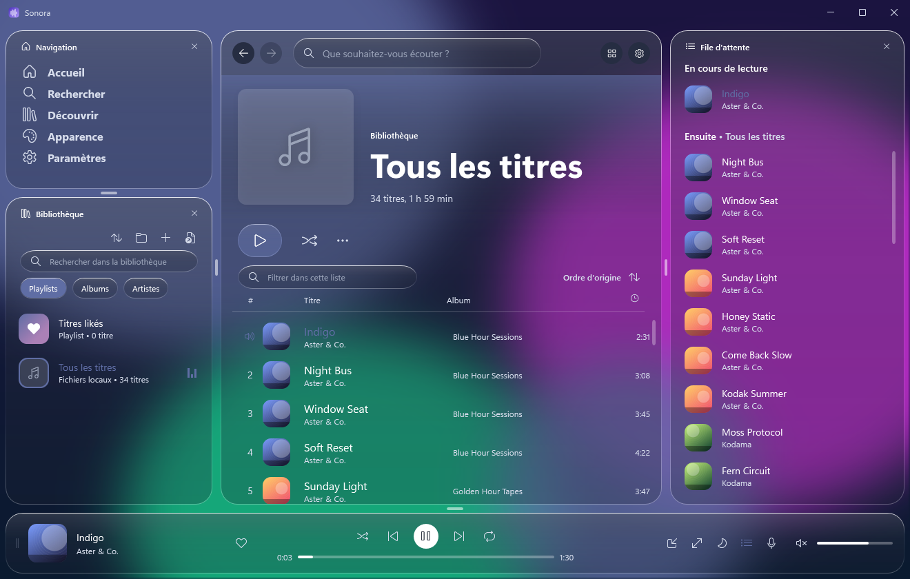
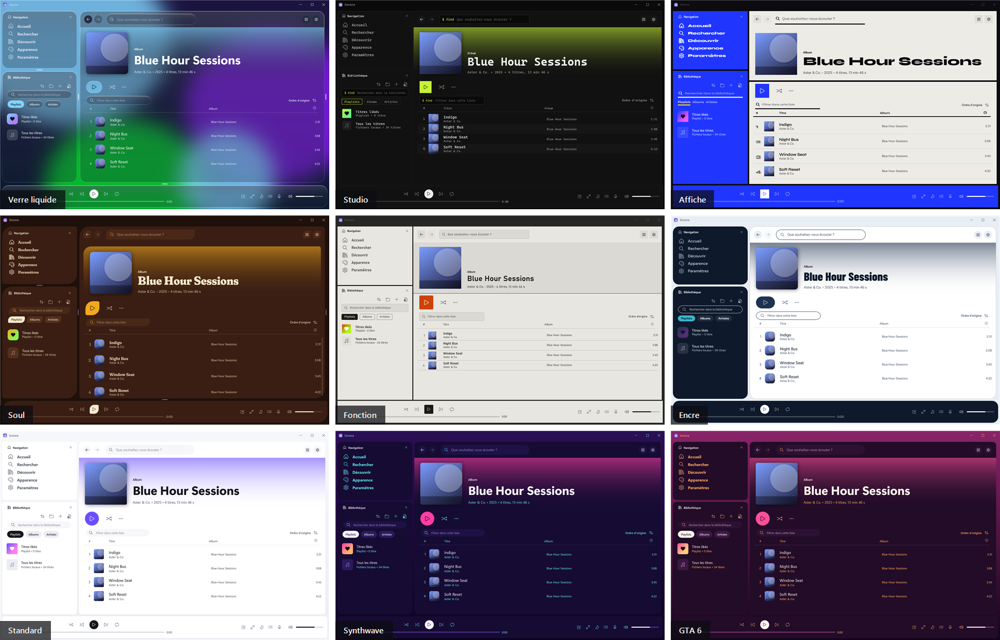
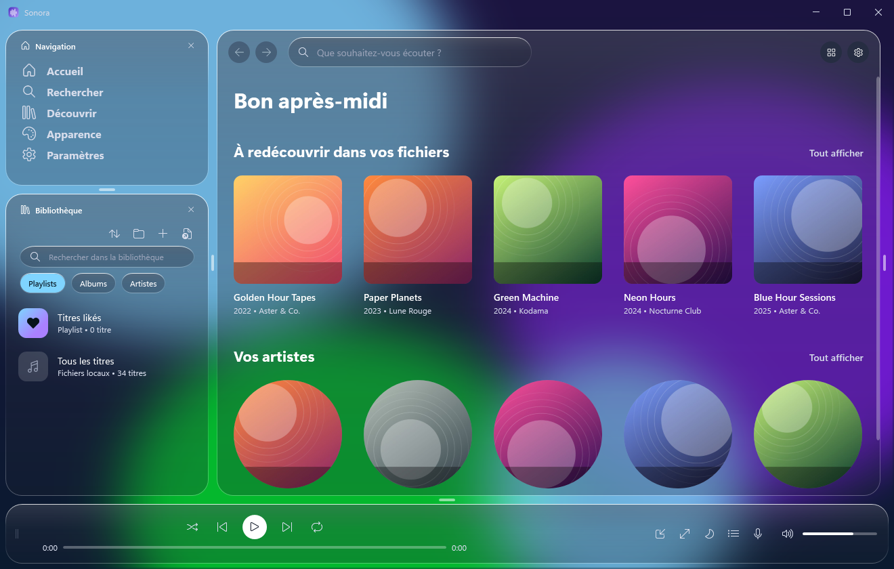
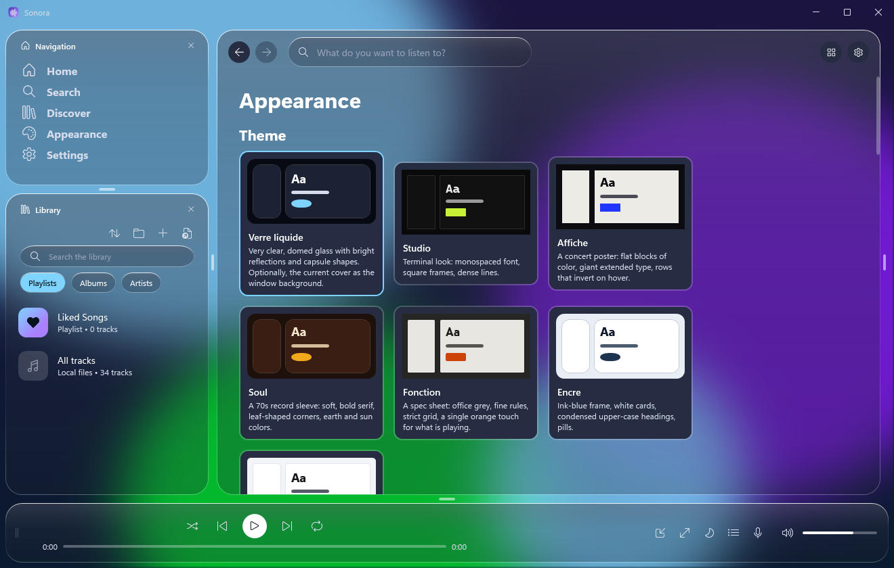
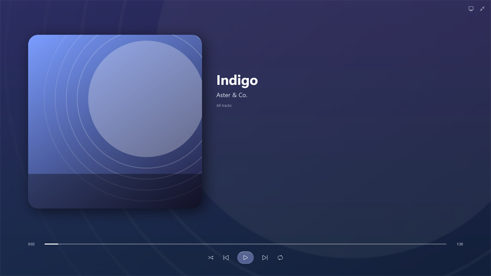
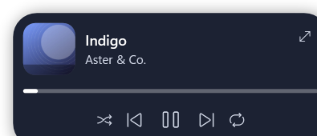

<div align="center">


# Sonora

**Un lecteur de musique pour Windows qui a l'allure que vous voulez.**<br>
Vos fichiers locaux et votre compte Spotify au même endroit, avec des thèmes, des panneaux déplaçables et quelques attentions bien pensées.

[](https://github.com/Tonoplas909/sonora-app/actions/workflows/ci.yml)
[](LICENSE)


[English](README.md) · [Français](README.fr.md)



</div>

> **Langues :** anglais, français, espagnol, allemand, italien, portugais, néerlandais, suédois, danois, norvégien, finnois et islandais. Seul le français a été relu par un locuteur natif ; les autres portent un badge *non relue* dans Réglages › Langue. Les corrections sont les bienvenues : [docs/TRANSLATING.md](docs/TRANSLATING.md).

## Pourquoi Sonora

La plupart des lecteurs imposent un seul look et une seule disposition. Sonora part de l'idée que c'est *vous* qui décidez : choisissez un thème, placez les panneaux où vous voulez, masquez ce que vous n'utilisez pas, et gardez votre bibliothèque locale et Spotify côte à côte.

C'est une application [WPF](https://learn.microsoft.com/dotnet/desktop/wpf/) native sur .NET 10, pas une page web dans une fenêtre. Le seul morceau web est un [WebView2](https://developer.microsoft.com/microsoft-edge/webview2/) invisible qui héberge le [Web Playback SDK](https://developer.spotify.com/documentation/web-playback-sdk) officiel de Spotify : c'est ainsi que Sonora apparaît comme un appareil **Spotify Connect** ordinaire.

## Fonctionnalités

**Fichiers locaux et Spotify, ensemble**
- Analyse vos dossiers de musique (MP3, FLAC, AAC/M4A, WAV, OGG, Opus, WMA, AIFF, ALAC), lit les étiquettes via Windows, trouve les pochettes dans le dossier et construit albums, artistes et genres.
- Se connecte à Spotify avec **votre propre** application développeur (PKCE, sans secret client) : playlists, albums enregistrés, artistes suivis, podcasts, titres likés, recherche, tops, historique et nouveautés des artistes que vous suivez.
- **Spotify Connect :** Sonora apparaît comme appareil, liste vos autres appareils, suit ce qui joue dessus et permet de le contrôler, ou de ramener la lecture sur Sonora.

**À votre image**
- **Sept thèmes**, chacun avec ses variantes de couleur : *Verre liquide*, *Studio* (terminal), *Affiche* (affiche de concert), *Soul* (pochette des années 70), *Fonction* (fiche technique), *Encre* et *Standard* (avec les palettes clair, OLED, papier, Synthwave et GTA 6). Un thème change les formes, les polices et les titres, pas seulement les couleurs.
- **Un éditeur de thèmes :** dupliquez un thème et changez ses couleurs, polices, arrondis, densité, fond (uni, dégradé, pochette en cours, ou votre image), puis importez ou exportez-le en petit fichier JSON.
- **Une icône qui suit le thème :** la fenêtre, le bouton de la barre des tâches et la barre de titre prennent la couleur d'accent du thème et la forme de ses coins (carrée pour Affiche, en feuille pour Soul…). Désactivable dans *Apparence*. L'icône du programme installé et du menu Démarrer ne change pas.
- **Panneaux ancrables :** navigation, bibliothèque, file d'attente, paroles et lecteur. Faites glisser l'en-tête d'un panneau pour l'ancrer de n'importe quel côté, redimensionnez avec les séparateurs, affichez ou masquez depuis le menu *Afficher*, réinitialisez en un clic.
- Réordonnez ou masquez les étagères de l'accueil, changez la taille des cartes, passez la bibliothèque en pochettes seules, épinglez vos favoris, réassignez chaque raccourci clavier.

**À l'écoute**
- **Paroles synchronisées** via [LRCLIB](https://lrclib.net) : la ligne en cours est mise en évidence et défile, un clic y saute.
- **Plein écran « en cours de lecture »** (`F11`) avec une pochette géante, déplaçable sur un autre écran ; un **mini-lecteur** qui peut rester au premier plan ; une bulle à chaque changement de titre ; un **minuteur de veille**.
- Touches multimédia et surcouche média de Windows, un panneau de file d'attente, et Sonora reprend où vous vous étiez arrêté.
- Glissez des titres sur une playlist, importez et exportez en **M3U**, filtrez et triez toute liste, recherche intelligente avec recherches récentes.

**Découverte et vie privée**
- Vos tops, votre historique, les nouveautés et vos statistiques d'écoute.
- **Artistes similaires** (MusicBrainz et ListenBrainz) et **scrobbling vers ListenBrainz** en option. Les deux sont désactivés tant que vous ne les activez pas. Aucune télémétrie.

**Léger pour la machine**
- Généralement 150 à 250 Mo ouvert (mesuré sur le PC de l'auteur), et l'interface rend sa mémoire à Windows quand elle est réduite ou en plein écran.

## Captures d'écran

<p align="center">
  <br>
  <sub>La même page dans Verre liquide, Studio, Affiche, Soul, Fonction, Encre, Standard, Synthwave et GTA 6.</sub>
</p>

<table>
  <tr>
    <td width="50%"><br><sub>Accueil</sub></td>
    <td width="50%"><br><sub>Apparence</sub></td>
  </tr>
  <tr>
    <td width="50%"><br><sub>Plein écran (<code>F11</code>)</sub></td>
    <td width="50%" align="center"><br><sub>Mini-lecteur</sub></td>
  </tr>
</table>

<sub>Toutes les captures utilisent une bibliothèque de démonstration fictive (artistes inventés, pochettes générées), voir [`tools/`](tools).</sub>

## Prérequis

- Windows 10 (version 2004 ou ultérieure) ou Windows 11, 64 bits.
- Le [runtime .NET 10 Desktop](https://dotnet.microsoft.com/download/dotnet/10.0), ou le SDK pour compiler depuis les sources.
- Pour Spotify : un compte **Spotify Premium**, le [runtime WebView2](https://developer.microsoft.com/microsoft-edge/webview2/) (déjà présent dans Windows 11 et dans un Windows 10 à jour) et une application développeur Spotify gratuite (ci-dessous).

L'installeur s'occupe du runtime .NET Desktop et de WebView2 s'ils manquent. Le zip, non.

## Installation

### Depuis une release

Ouvrez la dernière [release](https://github.com/Tonoplas909/sonora-app/releases/latest) et choisissez ce qui vous convient :

| | |
|---|---|
| **`SonoraApp-win-Setup.exe`** (recommandé) | L'installeur. Installe pour votre utilisateur sans droits administrateur, ajoute Sonora au menu Démarrer et aux *Applications installées*, apporte le runtime .NET Desktop et WebView2 s'ils manquent, et **se met à jour tout seul** (voir ci-dessous). |
| **`SonoraApp-win-Portable.zip`** | Sans installation : extrayez où vous voulez et lancez `Sonora.exe`. Il vous faut le [runtime .NET 10 Desktop](https://dotnet.microsoft.com/download/dotnet/10.0) et celui de WebView2. |

Windows peut afficher un avertissement SmartScreen pour un nouvel éditeur non signé : choisissez *Informations complémentaires*, puis *Exécuter quand même*.

### Mises à jour

Sonora cherche une nouvelle version à son ouverture (au plus une fois par heure) et vous prévient s'il y en a une. L'installation est toujours votre clic, dans *Paramètres › Mises à jour*, où se trouvent aussi un bouton **Rechercher des mises à jour** et l'interrupteur de la vérification automatique. Elle ne contacte que GitHub. Une copie compilée depuis les sources ne se met pas à jour toute seule : sa page de paramètres renvoie vers les releases.

### Compiler depuis les sources

```powershell
git clone https://github.com/Tonoplas909/sonora-app.git
cd sonora-app
dotnet run --project Sonora -c Release
```

Il vous faut le [SDK .NET 10](https://dotnet.microsoft.com/download/dotnet/10.0).

## Ajouter votre musique

Cliquez sur **Ajouter un dossier** sur la page d'accueil (ou sur le bouton dossier du panneau bibliothèque) et choisissez un dossier. Sonora l'analyse en arrière-plan, garde en cache ce qu'elle lit et repère les changements au lancement suivant.

## Connecter Spotify

Spotify n'autorise une application à agir pour un utilisateur que si elle a enregistré une *application développeur*. Sonora utilise donc la vôtre, ce qui veut aussi dire que vous ne partagez le quota de personne.

1. Ouvrez le [tableau de bord développeur Spotify](https://developer.spotify.com/dashboard) et **créez une application**. Cochez **Web API** et **Web Playback SDK**.
2. Ajoutez cette **adresse de redirection** (Sonora l'affiche avec un bouton de copie sur son écran de bienvenue et dans les Paramètres) :

   ```
   http://127.0.0.1:5543/callback
   ```
3. Copiez le **Client ID** de l'application, collez-le dans Sonora et cliquez sur **Se connecter avec Spotify**. Votre navigateur s'ouvre, vous acceptez, et vous revenez dans Sonora.

À savoir :
- La lecture Spotify demande un compte **Premium**.
- Une application en *mode développement* ne fonctionne que pour son propriétaire et les utilisateurs ajoutés dans *User management*, et elle est soumise aux limites de débit de Spotify. Voir [Dépannage](#dépannage) si Spotify répond « trop de requêtes ».
- Sonora ne garde qu'un jeton d'actualisation, chiffré avec la clé DPAPI de votre session Windows. Votre mot de passe Spotify ne passe jamais par Sonora.

## Raccourcis clavier

Tous sont réassignables dans *Paramètres › Raccourcis clavier*.

| Action | Par défaut | Action | Par défaut |
|---|---|---|---|
| Lecture / pause | `Espace` | File d'attente | `Ctrl`+`Q` |
| Titre suivant | `Ctrl`+`→` | Paroles | `Ctrl`+`P` |
| Titre précédent | `Ctrl`+`←` | Rechercher | `Ctrl`+`L` |
| Volume + / − | `Ctrl`+`↑` / `Ctrl`+`↓` | Filtrer la liste | `Ctrl`+`F` |
| Lecture aléatoire | `Ctrl`+`S` | Mini-lecteur | `Ctrl`+`M` |
| Répétition | `Ctrl`+`R` | Plein écran | `F11` |

En plein écran, `S` envoie la vue sur l'écran suivant et `Échap` la quitte. Les boutons précédent / suivant de la souris naviguent entre les pages.

## Vos données et votre vie privée

Tout ce que Sonora garde est dans `%LOCALAPPDATA%\Sonora` :

| Fichier ou dossier | Contenu |
|---|---|
| `state.json` | Réglages, playlists, le Client ID Spotify, votre jeton ListenBrainz si vous en avez mis un |
| `library.json`, `art\` | La bibliothèque locale analysée et le cache des pochettes |
| `themes\` | Vos propres thèmes (du JSON simple, faciles à partager) |
| `layout.json`, `window.json` | Disposition des panneaux et position de la fenêtre |
| `spotify.bin` | Le jeton d'actualisation Spotify, chiffré pour votre compte Windows |
| `spotify-cache.json` | Une copie de votre bibliothèque Spotify pour une ouverture instantanée |
| `listening.jsonl` | Votre propre historique d'écoute (désactivable dans *Fonctionnalités*) |

Sonora ne contacte que les services listés dans [THIRD-PARTY-NOTICES.md](THIRD-PARTY-NOTICES.md), chacun uniquement pour la fonction qui en a besoin. Cela inclut GitHub, pour chercher les mises à jour à l'ouverture (désactivable). **Il n'y a ni télémétrie ni compte chez nous.** Définissez la variable d'environnement `SONORA_DATA_DIR` pour utiliser un autre dossier, par exemple pour essayer l'application sur un profil vierge.

## Dépannage

- **« Spotify limite cette application (trop de requêtes)… »** Spotify peut refuser une application en mode développement pendant des heures quand elle fait trop de requêtes (un Retry-After de plusieurs heures a été vu sur `GET /me`). Sonora garde alors le lecteur, la liste des appareils et la télécommande en marche, cesse de redemander jusqu'à l'heure indiquée, puis actualise votre bibliothèque. Évitez de relancer l'application en boucle en attendant.
- **« Le port 5543 est déjà utilisé »** Un autre programme occupe le port de connexion. Fermez-le, ou trouvez-le avec `netstat -ano | findstr 5543`.
- **Pas de son avec Spotify** Vérifiez que votre compte est Premium et que le runtime WebView2 est installé. Sonora signale quand le navigateur n'a pas la protection Widevine exigée par Spotify.
- **Une liste Spotify est vide ou ancienne** Sonora affiche la copie enregistrée tant que Spotify ne répond pas. Elle se met à jour à la prochaine synchronisation réussie.

## Développer

```powershell
dotnet build Sonora.slnx          # tout
dotnet test Sonora.Tests          # tests unitaires
```

| Projet | Contenu |
|---|---|
| `Sonora/` | L'application WPF : fenêtres, vues, modèles de vue, code audio et Spotify |
| `Sonora.Appearance/` | La logique sans interface, facile à tester : thèmes, disposition des panneaux, réglages, raccourcis, paroles LRC, M3U, minuteur, classement de recherche |
| `Sonora.Tests/` | Tests xUnit de `Sonora.Appearance` |
| `tools/` | Scripts pour une bibliothèque de démo et les captures du README |
| `docs/design/` | Notes de conception, écrites au fil de l'eau (en français) |
| `docs/RELEASING.md` | Comment une release est fabriquée et signée |

Quelques diagnostics, depuis un `Sonora.exe` compilé :

```powershell
Sonora.exe --snapshot out.png appearance --theme soul   # rend une vue en PNG puis quitte
$env:SONORA_DATA_DIR = "$env:TEMP\sonora-demo\data"     # utilise un profil jetable
```

`tools\New-DemoProfile.ps1` fabrique une bibliothèque fictive pour essayer l'application, et `tools\Update-Screenshots.ps1` régénère toutes les images de ce README à partir d'elle.

## Contribuer

Rapports de bugs, idées, traductions et pull requests sont les bienvenus. Lisez d'abord [CONTRIBUTING.md](CONTRIBUTING.md), et [SECURITY.md](SECURITY.md) pour signaler une vulnérabilité. Ce projet suit un [code de conduite](CODE_OF_CONDUCT.md).

## Licence

[MIT](LICENSE) © Sonora contributors. Les polices embarquées sont sous SIL Open Font License ; voir [THIRD-PARTY-NOTICES.md](THIRD-PARTY-NOTICES.md).

Spotify est une marque de Spotify AB. Sonora est un projet indépendant, non affilié à Spotify et non approuvé par lui.
