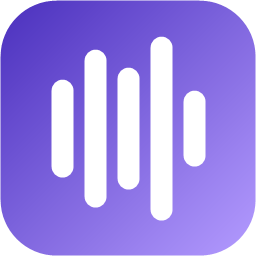
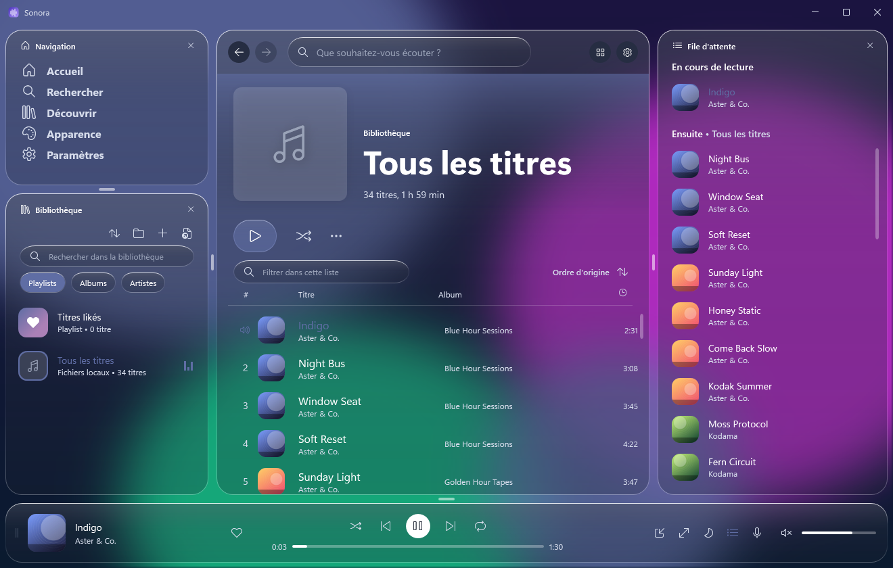
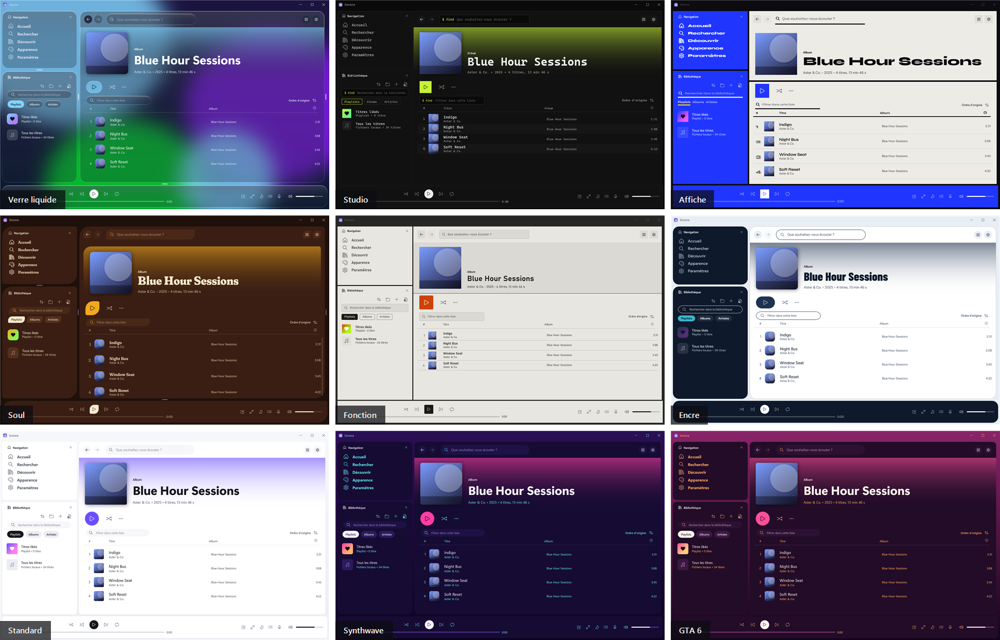
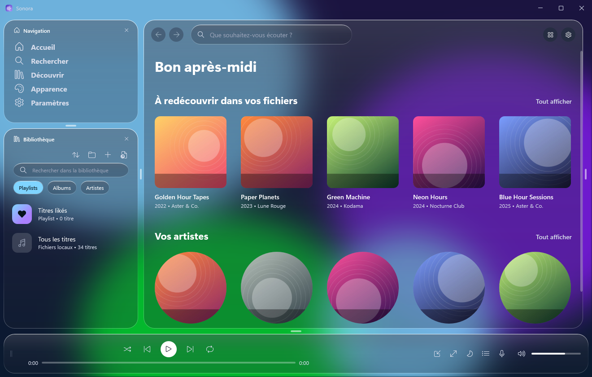
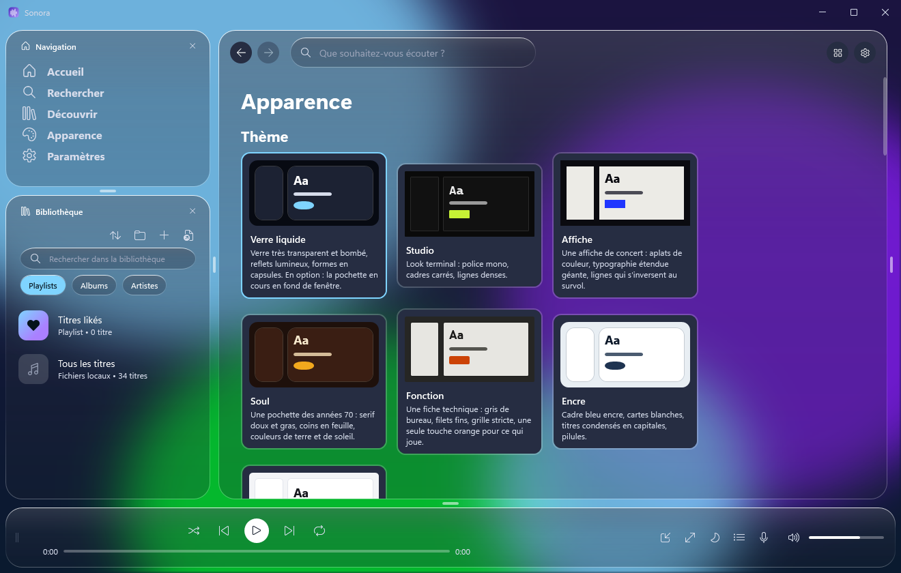
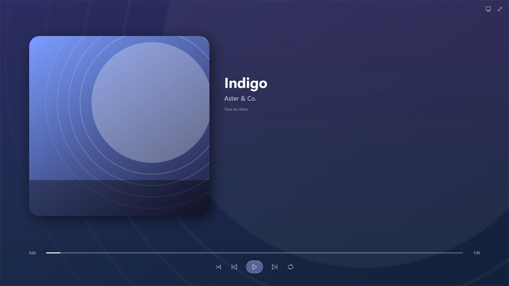
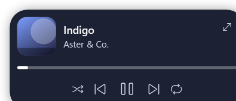

<div align="center">



# Sonora

**A music player for Windows that looks the way you want it to.**<br>
Your local files and your Spotify account in one place, with themes, dockable panels and a few thoughtful extras.

[](https://github.com/Tonoplas909/sonora-app/actions/workflows/ci.yml)
[](LICENSE)


[English](README.md) · [Français](README.fr.md)



</div>

> **Heads-up:** the interface is currently in **French** only. Translations are very welcome, see [Contributing](CONTRIBUTING.md).

## Why Sonora

Most players give you one look and one layout. Sonora is built around the idea that *you* decide: pick a theme, drag panels where you want them, hide what you don't use, and keep your local library and Spotify side by side.

It is a native [WPF](https://learn.microsoft.com/dotnet/desktop/wpf/) application on .NET 10, not a web page in a window. The one web part is an invisible [WebView2](https://developer.microsoft.com/microsoft-edge/webview2/) that hosts Spotify's official [Web Playback SDK](https://developer.spotify.com/documentation/web-playback-sdk), which is how Sonora shows up as a regular **Spotify Connect** device.

## Features

**Local files and Spotify, together**
- Scans your music folders (MP3, FLAC, AAC/M4A, WAV, OGG, Opus, WMA, AIFF, ALAC), reads tags through Windows, finds covers in the folder, and builds albums, artists and genres.
- Signs in to Spotify with **your own** developer application (PKCE, no client secret): playlists, saved albums, followed artists, podcasts, liked songs, search, top tracks and artists, history and new releases from the artists you follow.
- **Spotify Connect:** Sonora appears as a device, lists your other devices, follows what plays on them and lets you control it, or move playback back to Sonora.

**Make it yours**
- **Seven themes**, each with colour variants: *Verre liquide*, *Studio* (terminal), *Affiche* (concert poster), *Soul* (70s record sleeve), *Fonction* (spec sheet), *Encre* and *Standard* (with light, OLED, paper, Synthwave and GTA 6 palettes). A theme changes shapes, fonts and titles, not just colours.
- **A theme editor:** duplicate any theme and change its colours, fonts, corner radius, density, background (solid, gradient, the current cover, or your own picture), then import or export it as a small JSON file.
- **Dockable panels:** navigation, library, queue, lyrics and player. Drag a panel's header to dock it to any side, resize with splitters, show or hide from the *Afficher* menu, reset in one click.
- Reorder or hide the home shelves, resize the cards, switch the library to covers only, pin your favourites, rebind every keyboard shortcut.

**Listening**
- **Synchronized lyrics** from [LRCLIB](https://lrclib.net): the current line is highlighted and scrolls, a click jumps to it.
- **Full-screen "now playing"** (`F11`) with a giant cover, movable to another monitor; a **mini-player** that can stay on top; a bubble when the track changes; a **sleep timer**.
- Media keys and the Windows media overlay, a queue panel, and Sonora picks up where you stopped.
- Drag tracks onto playlists, import and export **M3U**, filter and sort any list, smart search with recent searches.

**Discovery and privacy**
- Your tops, history, new releases and listening statistics.
- Optional **similar artists** (MusicBrainz and ListenBrainz) and optional **scrobbling to ListenBrainz**. Both are off until you turn them on. There is no telemetry.

**Light on the machine**
- Typically 150 to 250 MB while open (measured on the author's PC), and the interface hands its memory back to Windows when minimized or in full screen.

## Screenshots

<p align="center">
  <br>
  <sub>The same page in Verre liquide, Studio, Affiche, Soul, Fonction, Encre, Standard, Synthwave and GTA 6.</sub>
</p>

<table>
  <tr>
    <td width="50%"><br><sub>Home</sub></td>
    <td width="50%"><br><sub>Appearance</sub></td>
  </tr>
  <tr>
    <td width="50%"><br><sub>Full screen (<code>F11</code>)</sub></td>
    <td width="50%" align="center"><br><sub>Mini-player</sub></td>
  </tr>
</table>

<sub>All screenshots use a fictional demo library (invented artists, generated covers), see [`tools/`](tools).</sub>

## Requirements

- Windows 10 (version 2004 or later) or Windows 11, 64-bit.
- The [.NET 10 Desktop Runtime](https://dotnet.microsoft.com/download/dotnet/10.0), or the SDK if you build from source.
- For Spotify: a **Spotify Premium** account, the [WebView2 Runtime](https://developer.microsoft.com/microsoft-edge/webview2/) (already part of Windows 11 and up-to-date Windows 10) and a free Spotify developer application (below).

The installer takes care of the .NET Desktop Runtime and WebView2 if they are missing. The zip does not.

## Install

### From a release

Open the latest [release](https://github.com/Tonoplas909/sonora-app/releases/latest) and pick what suits you:

| | |
|---|---|
| **`SonoraApp-win-Setup.exe`** (recommended) | The installer. Installs for your user without administrator rights, adds Sonora to the Start menu and to *Installed apps*, brings the .NET Desktop Runtime and WebView2 if they are missing, and **keeps itself up to date** (see below). |
| **`SonoraApp-win-Portable.zip`** | No installation: unzip anywhere and run `Sonora.exe`. You need the [.NET 10 Desktop Runtime](https://dotnet.microsoft.com/download/dotnet/10.0) and the WebView2 Runtime yourself. |

Windows may show a SmartScreen warning for a new, unsigned publisher: choose *More info*, then *Run anyway*.

### Updates

Sonora looks for a new version when it opens (at most once an hour) and tells you when there is one. Installing is always your click, in *Paramètres › Mises à jour*, where you also find a **Rechercher des mises à jour** button and the switch to turn the automatic check off. The check only contacts GitHub. A copy built from source does not update itself: its settings page points to the releases instead.

### Build from source

```powershell
git clone https://github.com/Tonoplas909/sonora-app.git
cd sonora-app
dotnet run --project Sonora -c Release
```

You need the [.NET 10 SDK](https://dotnet.microsoft.com/download/dotnet/10.0).

## Add your music

Click **Ajouter un dossier** on the home page (or the folder button in the library panel) and pick a folder. Sonora scans it in the background, caches what it reads, and picks up changes next time.

## Connect Spotify

Spotify only lets an application act for a user once it has registered a *developer application*. Sonora therefore uses yours, which also means no one else's quota is shared with you.

1. Open the [Spotify developer dashboard](https://developer.spotify.com/dashboard) and **create an app**. Tick **Web API** and **Web Playback SDK**.
2. Add this **redirect URI** (Sonora shows it with a copy button on its welcome screen and in Settings):

   ```
   http://127.0.0.1:5543/callback
   ```
3. Copy the app's **Client ID**, paste it into Sonora, and click **Se connecter avec Spotify**. Your browser opens, you accept, and you're back in Sonora.

Good to know:
- Spotify playback needs a **Premium** account.
- An app in Spotify's *development mode* only works for its owner and the users you add under *User management*, and it is subject to Spotify's rate limits. See [Troubleshooting](#troubleshooting) if Spotify answers "too many requests".
- Sonora stores only a refresh token, encrypted with the Windows user's DPAPI key. Your Spotify password never goes through Sonora.

## Keyboard shortcuts

All of these can be rebound in *Paramètres › Raccourcis clavier*.

| Action | Default | Action | Default |
|---|---|---|---|
| Play / pause | `Space` | Queue | `Ctrl`+`Q` |
| Next track | `Ctrl`+`→` | Lyrics | `Ctrl`+`P` |
| Previous track | `Ctrl`+`←` | Search | `Ctrl`+`L` |
| Volume up / down | `Ctrl`+`↑` / `Ctrl`+`↓` | Filter the list | `Ctrl`+`F` |
| Shuffle | `Ctrl`+`S` | Mini-player | `Ctrl`+`M` |
| Repeat | `Ctrl`+`R` | Full screen | `F11` |

In full screen, `S` sends the view to the next monitor and `Esc` leaves it. Back / forward mouse buttons navigate between pages.

## Your data and your privacy

Everything Sonora keeps is in `%LOCALAPPDATA%\Sonora`:

| File or folder | What it is |
|---|---|
| `state.json` | Settings, playlists, the Spotify Client ID, your ListenBrainz token if you set one |
| `library.json`, `art\` | The scanned local library and cover cache |
| `themes\` | Your own themes (plain JSON, easy to share) |
| `layout.json`, `window.json` | Panel layout and window position |
| `spotify.bin` | The Spotify refresh token, encrypted for your Windows account |
| `spotify-cache.json` | A copy of your Spotify library so the app opens instantly |
| `listening.jsonl` | Your own play history (off in *Fonctionnalités*) |

Sonora talks only to the services listed in [THIRD-PARTY-NOTICES.md](THIRD-PARTY-NOTICES.md), each only for the feature that needs it. That includes GitHub, to look for updates when it opens (you can switch that off). **There is no telemetry and no account of ours.** Set the `SONORA_DATA_DIR` environment variable to use another folder, for example to try the app on a clean profile.

## Troubleshooting

- **"Spotify limite cette application (trop de requêtes)…"** Spotify can refuse a development-mode app for hours when it makes too many requests (a Retry-After of several hours has been seen on `GET /me`). Sonora then keeps the player, the devices list and the remote control running, stops asking until the time shown, and refreshes your library afterwards. Avoid restarting the app repeatedly in the meantime.
- **"Le port 5543 est déjà utilisé"** Another program holds the sign-in port. Close it, or find it with `netstat -ano | findstr 5543`.
- **No sound from Spotify** Check that your account is Premium and that the WebView2 Runtime is installed. Sonora tells you when the browser lacks the Widevine protection Spotify requires.
- **A Spotify list is empty or old** Sonora shows the saved copy while Spotify can't answer. It updates on the next successful sync.

## Develop

```powershell
dotnet build Sonora.slnx          # everything
dotnet test Sonora.Tests          # unit tests
```

| Project | What it holds |
|---|---|
| `Sonora/` | The WPF application: windows, views, view models, audio and Spotify code |
| `Sonora.Appearance/` | UI-free logic, easy to test: themes, dock layout, settings, shortcuts, LRC lyrics, M3U, sleep timer, search ranking |
| `Sonora.Tests/` | xUnit tests for `Sonora.Appearance` |
| `tools/` | Scripts for a demo library and the README screenshots |
| `docs/design/` | Design notes, written along the way (in French) |
| `docs/RELEASING.md` | How a release is made and signed |

Handy diagnostics, run from a built `Sonora.exe`:

```powershell
Sonora.exe --snapshot out.png appearance --theme soul   # render a view to a PNG and exit
$env:SONORA_DATA_DIR = "$env:TEMP\sonora-demo\data"     # use a throwaway profile
```

`tools\New-DemoProfile.ps1` builds a fictional library to try the app on, and `tools\Update-Screenshots.ps1` regenerates every image of this README from it.

## Contributing

Bug reports, ideas, translations and pull requests are welcome. Please read [CONTRIBUTING.md](CONTRIBUTING.md) first, and [SECURITY.md](SECURITY.md) to report a vulnerability. This project follows a [Code of Conduct](CODE_OF_CONDUCT.md).

## License

[MIT](LICENSE) © Sonora contributors. Bundled fonts are under the SIL Open Font License; see [THIRD-PARTY-NOTICES.md](THIRD-PARTY-NOTICES.md).

Spotify is a trademark of Spotify AB. Sonora is an independent project, not affiliated with or endorsed by Spotify.
